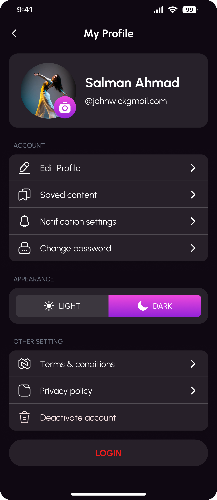
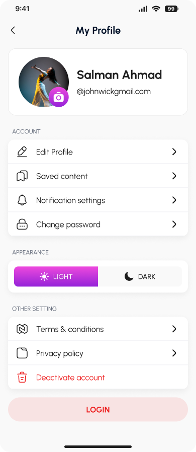
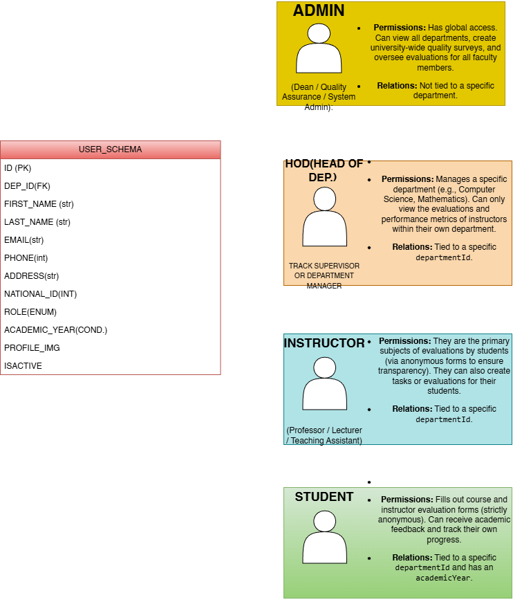
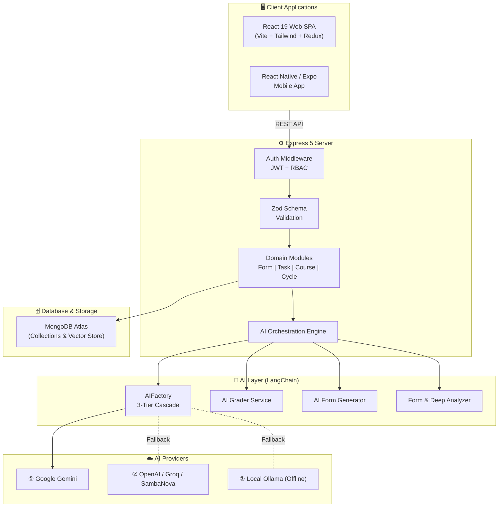

<div align="center">

# 🚀 InsightO — Smart Educational & Organizational Intelligence Platform

  <p align="center">
    <strong>Bridging Qualitative Feedback & Quantitative Evaluation through Resilient Multi-Model AI</strong>
  </p>

  <p align="center">
    <a href="https://react.dev/"></a>
    <a href="https://www.typescriptlang.org/"></a>
    <a href="https://expressjs.com/"></a>
    <a href="https://www.mongodb.com/"></a>
    <a href="https://js.langchain.com/"></a>
    <a href="https://tailwindcss.com/"></a>
    <a href="https://vitejs.dev/"></a>
    <a href="./LICENSE"></a>
  </p>

</div>

---

## 📸 Platform Interface Showcase

<table>
  <thead>
    <tr>
      <th align="center">🌙 Dark Mode Analytics Dashboard</th>
      <th align="center">☀️ Light Mode Experience</th>
    </tr>
  </thead>
  <tbody>
    <tr>
      <td align="center"></td>
      <td align="center"></td>
    </tr>
    <tr>
      <td align="center">Real-time evaluation trends, sentiment mapping, and performance analytics</td>
      <td align="center">Clean, high-contrast user interface tailored for seamless accessibility</td>
    </tr>
  </tbody>
</table>

<br>

<div align="center">
  <h3>🗺️ System Schema Architecture</h3>
  
</div>

---

## 🤔 Why InsightO?

> **The Problem:** Educational institutions collect mountains of feedback surveys and student assignments — but lack the tools to extract *actionable intelligence* from them. Feedback data lives in disconnected silos. Grading is inconsistent and manual. Trend analysis takes weeks. Systemic bottlenecks go undetected for entire semesters.

> **The Solution:** InsightO creates a **unified evaluation ecosystem** that merges *qualitative sentiment* (survey feedback) with *quantitative performance* (AI-graded submissions) to deliver a **360-degree institutional health report**.

---

## 💡 The Business Impact

| Challenge | InsightO's Answer |
| :--- | :--- |
| **Fragmented Feedback** | Centralized survey engine with AI-tagged categorization and cross-category deep analysis |
| **Inconsistent Grading** | Automated, rubric-aware AI grading with criteria breakdowns and concept mastery mapping |
| **Blind Spots in Quality** | Multi-entity profiling (Students, Instructors, Courses, Facilities) with historical trend tracking |
| **Reactive Decision-Making** | Instant, data-driven **AI Action Plans** that surface root causes and prescribe concrete next steps |
| **AI Service Interruptions** | **Resilient 3-Tier AI Fallback** architecture ensuring zero downtime for all AI features |

---

## ✨ Key Features

### 🛡️ Resilient AI Architecture — 3-Tier Fallback System

> *This is not a wrapper around a single API. It's a production-grade AI orchestration layer.*

InsightO's AI backbone is engineered for **zero downtime**. The `AIFactory` class implements an intelligent multi-provider cascade:

```
┌─────────────────────────────────────────────────────────┐
│                   AI Provider Cascade                   │
│                                                         │
│   ① Google Gemini (gemini-1.5-flash)                    │
│      ↓ if unavailable                                   │
│   ② OpenAI (gpt-4o-mini) / Groq (llama-3.1-8b-instant) │
│      │  ↳ Auto-detects provider by API key prefix       │
│      │  ↳ gsk_ → Groq  |  sbg_ → SambaNova             │
│      ↓ if unavailable                                   │
│   ③ Local Ollama (llama3.1:8b) — fully offline          │
│      ↳ No external dependencies, runs on localhost      │
└─────────────────────────────────────────────────────────┘
```

**Why this matters:**
- **Cost Optimization** — Route to the cheapest viable provider first.
- **Vendor Lock-in Prevention** — Swap providers without touching feature code.
- **Offline Capability** — Local Ollama fallback operates without active internet connections.
- **Unified Interface** — All AI features (grading, analysis, form generation, profiling) consume the same factory interface.

---

### 📊 Automated AI Grading Engine

The `aiGrader.service.ts` powers a multi-format grading pipeline:
- **Text & File Submissions** → Deep LLM reasoning with optional rubric enforcement.
- **MCQ (Multiple Choice)** → Deterministic scoring ($0$ or $100$).
- **MSQ (Multiple Select)** → Partial-credit scoring ($\frac{\text{correct\_selected}}{\text{total\_correct}} \times 100$).
- **Rich Output Metrics**: Every graded submission returns:
  - `criteria_breakdown` — Dimensional scoring (Logic, Optimization, Readability, Security).
  - `concept_mastery` — Per-concept mastery levels with `EXCELLENT`, `GOOD`, or `CRITICAL` status flags.
  - `quality_metrics` — Readability, Complexity, and Security Guardrails scores.
- **File Parsing** → Automatically parses `.pdf`, `.pptx`, and text files prior to grading.

---

### 🧩 AI-Powered Dynamic Form Builder

- **Prompt-to-Form** → Describe an assessment in natural language to generate a structured survey with typed questions (`short_text`, `long_text`, `linear_scale`, `multiple_choice`, `checkbox`, `file`).
- **File-to-Form** → Upload a PDF or PowerPoint; the AI extracts key concepts and constructs quiz questions with random sampling from document chunks.
- **Bilingual Engine** → Seamlessly generates forms in **English** or **Arabic** based on language preference.
- **Schema Validation** → Strictly enforces Zod schema rules on option arrays, text validations, and scale configurations.

---

### 🔬 Deep Form Analytics & AI Action Plans

1. **Tag-Level Analysis** — Groups submissions by semantic `ai_tag`, running parallel LLM analysis per category (strengths, weaknesses, sentiment score).
2. **Deep Cross-Category Synthesis** — Feeds all tag results into a global analysis prompt to detect **systemic organizational bottlenecks**.
3. **Comparative Historical Tracking** — Tracks entities (Departments, Courses, Instructors, Facilities) across cycles to surface growth or decay.
4. **Token-Guarded** — Every LLM execution passes through token limit enforcers with graceful fallback handling.

---

### 👤 Comprehensive Multi-Entity Profiling

| Entity | Profile Breakdown |
| :--- | :--- |
| **Student** | Aggregated grades, concept mastery levels, persistent weaknesses, AI-synthesized performance summary |
| **Instructor** | Teaching quality trends, communication feedback, cross-cycle evaluation curves |
| **Course** | Curriculum clarity, difficulty analysis, content update recommendations |
| **Facility** | Service availability, safety standards, visitor satisfaction tracking |

---

### 🔐 Role-Based Access Control (RBAC)

| Role | Capabilities |
| :--- | :--- |
| **Admin** | Platform configuration, full user CRUD, token usage dashboards, department oversight |
| **HOD** (Head of Dept.) | Department-scoped analytics, instructor management, evaluation cycle execution |
| **Instructor** | Form creation, task assignment, AI grading, submission review |
| **Student** | Survey responses, task submissions, personal performance dashboard |

---

### 🏗️ Backend Engineering Highlights

- **Decoupled Schema Validation** — Zod schemas are isolated from Mongoose models for clean API contracts.
- **Optimized Aggregation** — MongoDB aggregation pipelines for token usage dashboards and evaluation history without $N+1$ query issues.
- **AI Quotas & Metering** — Per-user token consumption is tracked in a dedicated `TokenUsage` collection with configurable quotas.
- **Async Error Boundary** — Custom `asyncWrap` middleware with centralized `AppError` class for consistent HTTP error responses.
- **Modular Architecture** — Domain-driven structure (`Auth`, `Form`, `Question`, `Submission`, `Task`, `Course`, `Cycle`, `Facility`, `AI`).

---

## 🛠️ Tech Stack

### Frontend Application
| Technology | Purpose |
| :--- | :--- |
| **React 19** | Modern UI framework with concurrent rendering |
| **TypeScript 5.9** | End-to-end type safety |
| **Vite 8** | High-performance build tool with instant HMR |
| **Redux Toolkit + Zustand** | Dual state management (Global state via RTK, local component state via Zustand) |
| **React Router v7** | Declarative nested routing |
| **Tailwind CSS 4** | Utility-first styling with custom design tokens |
| **Shadcn/UI + Radix** | Accessible, unstyled UI primitives |
| **Framer Motion** | Production micro-animations |
| **Recharts** | Data visualization and analytics charts |
| **React Hook Form + Zod** | Form handling with schema-level validation |
| **i18next** | Multi-language support (English / Arabic) |
| **@dnd-kit** | Drag-and-drop form builder interface |

### Backend API Server
| Technology | Purpose |
| :--- | :--- |
| **Node.js + Express 5** | HTTP API server with modern routing |
| **TypeScript 6** | Full-stack type compliance |
| **Mongoose 9 + MongoDB** | Object Data Modeling & MongoDB Atlas |
| **LangChain Ecosystem** | LLM orchestration (Chains, Prompt Templates, Document Loaders) |
| **@langchain/google-genai** | Google Gemini API integration |
| **@langchain/openai** | OpenAI / Groq / SambaNova integrations |
| **@langchain/ollama** | Local offline AI inference |
| **@langchain/mongodb** | MongoDB Atlas Vector Search for RAG |
| **Zod** | Schema validation middleware |
| **JWT + bcryptjs** | Stateless authentication & secure password hashing |
| **Multer** | Multipart form file upload processing |
| **officeparser + pdf-parse** | Document content extraction |

---

## 📁 Monorepo Architecture

```
InsightO/
├── 📂 assets/                       # Platform screenshots & schema diagrams
├── 📂 InsightO-Backend/             # Express.js API Server
│   ├── 📄 server.ts                 # Entry point — server initialization & DB connect
│   ├── 📄 app.ts                    # Express application setup & middleware stack
│   ├── 📄 API_DOCUMENTATION.md     # Full backend REST API reference documentation
│   ├── 📄 InsightO_Backend_All_Endpoints.postman_collection.json # API testing collection
│   ├── 📂 config/                   # Database connection setup
│   ├── 📂 middlewares/              # Auth, Zod validation, error handlers
│   ├── 📂 modules/                  # Feature domain modules
│   │   ├── 📂 AI/                   # AI Grading, Form Generation & Profiling Services
│   │   ├── 📂 auth/                 # Authentication & Role Management
│   │   ├── 📂 form/                 # Forms & Surveys CRUD
│   │   ├── 📂 question/             # Dynamic Questions Engine
│   │   ├── 📂 submission/           # Form Submissions Engine
│   │   ├── 📂 task/                 # Academic Tasks
│   │   ├── 📂 taskSubmittion/       # Task Submissions & AI Grading
│   │   ├── 📂 student/              # Student Domain
│   │   ├── 📂 course/               # Course Domain
│   │   ├── 📂 cycle/                # Evaluation Cycles
│   │   ├── 📂 department/           # Department Domain
│   │   ├── 📂 facility/             # Facility Domain
│   │   └── 📂 admin/                # Admin Dashboard APIs
│   ├── 📂 services/                 # AI Provider Cascade & Aggregation Services
│   └── 📂 utils/                    # Token tracking, Email, AppError
│
├── 📂 frontend/                     # React 19 + Vite Web Application
│   ├── 📄 index.html                # HTML entry point
│   ├── 📄 vite.config.ts            # Vite configuration
│   ├── 📄 tailwind.config.js        # Tailwind CSS configuration
│   └── 📂 src/                      # Source code
│       ├── 📂 app/                  # Redux store configuration
│       ├── 📂 features/             # FormBuilder, Analytics, Portals, Settings
│       └── 📂 components/           # Reusable UI primitives
│
├── 📂 mobile/                       # React Native / Expo Mobile Application
│   ├── 📄 App.tsx                   # Mobile entry component
│   ├── 📄 app.json                  # Expo config
│   └── 📂 src/                      # Mobile views, components, context
│
├── 📄 .gitignore                    # Monorepo ignore rules
├── 📄 LICENSE                       # MIT License
└── 📄 README.md                     # Platform Documentation
```

---

## 🚀 Getting Started

### Prerequisites

| Tool | Recommended Version |
| :--- | :--- |
| **Node.js** | `v18.0.0` or higher |
| **npm** | `v9.0.0` or higher |
| **MongoDB** | Local MongoDB instance or MongoDB Atlas Cluster |
| **Ollama** *(Optional)* | For local offline AI capabilities |

---

### 1. Clone the Repository

```bash
git clone https://github.com/YOUR_USERNAME/InsightO.git
cd InsightO
```

---

### 2. Backend Setup

```bash
cd InsightO-Backend
npm install
```

Create a `.env` file inside `InsightO-Backend/` (or copy from `.env.example`):

```env
# Server
PORT=5000

# Database
MONGO_URI=mongodb+srv://<username>:<password>@cluster0.mongodb.net/insighto

# Authentication
JWT_SECRET=your_super_secret_jwt_key

# AI Providers (At least one required)
GOOGLE_API_KEY=your_google_gemini_api_key
OPENAI_API_KEY=your_openai_or_groq_api_key
OLLAMA_BASE_URL=http://localhost:11434

# Email Service
EMAIL_USER=your_email@gmail.com
EMAIL_PASS=your_app_password
```

Start the backend server:

```bash
npm run dev
```
> The Express API server will start on `http://localhost:5000`.

---

### 3. Frontend Web Setup

```bash
cd ../frontend
npm install
npm run dev
```
> The Vite dev server will start on `http://localhost:5173` with instant HMR.

---

### 4. Mobile App Setup (Optional)

```bash
cd ../mobile
npm install
npx expo start
```

---

### 5. Local Offline AI Setup (Optional)

For offline AI fallback using Ollama:

```bash
# Install Ollama from https://ollama.ai
ollama pull llama3.1:8b
ollama pull nomic-embed-text
```

---

## 🔌 API Documentation Overview

The backend exposes a structured RESTful API. Below are key endpoint namespaces:

| Endpoint Prefix | Description | Auth Required |
| :--- | :--- | :---: |
| `/api/auth` | User registration, login, password resets, OTP | ❌ |
| `/api/v1/form` | Form creation, updates, sharing, listing | ✅ |
| `/api/v1/questions` | Dynamic question configuration | ✅ |
| `/api/forms/:formId/submissions` | Survey response submission & retrieval | Varies |
| `/api/tasks` | Academic task assignments | ✅ |
| `/api/task-submissions` | Student submissions & AI grading triggering | ✅ |
| `/api/ai/analyze-form/:formId` | Tag-level AI form analysis | ✅ |
| `/api/ai/analyze-form/:formId/deep` | Cross-category deep AI synthesis | ✅ |
| `/api/ai/generate-form` | Prompt-to-Form & File-to-Form AI generation | ✅ |
| `/api/ai/token-usage` | User AI consumption & quota stats | ✅ |
| `/api/admin/*` | Global user CRUD & system metrics | ✅ (Admin) |

> 📖 Detailed endpoint schemas and payload examples are available in [`InsightO-Backend/API_DOCUMENTATION.md`](./InsightO-Backend/API_DOCUMENTATION.md).  
> 🧪 A complete Postman Collection is included at [`InsightO-Backend/InsightO_Backend_All_Endpoints.postman_collection.json`](./InsightO-Backend/InsightO_Backend_All_Endpoints.postman_collection.json).

---

## 📐 System Architecture Diagram



---

## 👨‍💻 Contributors & Authors

<table align="center">
  <tbody>
    <tr>
      <td align="center" width="25%">
        <a href="https://github.com/OthmanA6">
          
          <br />
          <sub><b>Othman Abdelrazik</b></sub>
        </a>
        <br />
        <sub>Full-Stack Developer</sub>
        <br />
        <a href="mailto:osmanabdelrazik@gmail.com">✉️ Email</a>
      </td>
      <td align="center" width="25%">
        <a href="https://github.com/3mrNour">
          
          <br />
          <sub><b>Amr Nour</b></sub>
        </a>
        <br />
        <sub>Full-Stack Developer</sub>
        <br />
        <a href="https://www.linkedin.com/in/amrnour1/">💼 LinkedIn</a>
      </td>
      <td align="center" width="25%">
        <a href="https://github.com/Mohamedali22710">
          
          <br />
          <sub><b>Mohamed Ali</b></sub>
        </a>
        <br />
        <sub>Full-Stack Developer</sub>
        <br />
        <a href="https://www.linkedin.com/in/mohamedali74/">💼 LinkedIn</a>
      </td>
      <td align="center" width="25%">
        <a href="https://github.com/Demrdash">
          
          <br />
          <sub><b>Dmerdash Mohamed</b></sub>
        </a>
        <br />
        <sub>Full-Stack Developer</sub>
        <br />
        <a href="https://www.linkedin.com/in/dmerdash/">💼 LinkedIn</a>
      </td>
    </tr>
  </tbody>
</table>

---

<p align="center">
  <strong>Built with 💙 and an unreasonable amount of ☕</strong>
  <br>
  <em>InsightO — Because data without insight is just noise.</em>
</p>
