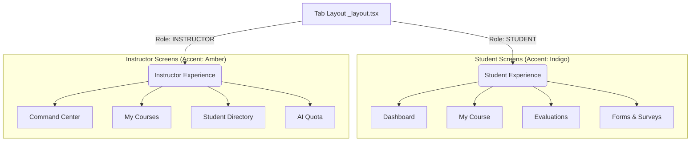

# مقارنة تصميم تجربة الطالب والمدرب (Student vs. Instructor Design Comparison)

يقدم هذا المستند مقارنة هيكلية وتصميمية شاملة بين واجهة تجربة الطالب وواجهة تجربة المدرب في التطبيق بناءً على تحليل الكود المصدري.

---

## 📊 جدول المقارنة السريع (Quick Comparison Table)

| عنصر التصميم (UI Element) | تجربة الطالب (Student Experience) | تجربة المدرب (Instructor Experience) |
| :--- | :--- | :--- |
| **اللون الأساسي (Accent Color)** | البنفسجي / النيلي (`#6366f1` / `#4f46e5`) | البرتقالي / الكهرماني (`#F59E0B`) |
| **لون الخلفية (Background)** | متدرج داكن `['#090514', '#0c0a1a', '#02010a']` | لون داكن موحد مصمت `#0B1120` |
| **إضاءات الخلفية (Ambient Glow)** | متوفرة عبر كرات ضوئية (`glowOrb`) ملونة | غير متوفرة (تصميم رسمي ومباشر) |
| **شريط التنقل (Bottom Tab Bar)** | عائم، خفيف (ارتفاع 70)، **بدون عناوين** (أيقونات فقط) | عائم، أعرض (ارتفاع 80)، **مع عناوين نصية** |
| **الترويسة العليا (Headers)** | مخفية من النظام (`headerShown: false`)، تُبنى يدوياً | ترويسة النظام الافتراضية مع زر الملف الشخصي |
| **الحركات (Animations)** | تفاعلية وحركية غنية (`react-native-animatable`) | سريعة ومباشرة بدون أنيميشن انتقالي |
| **كثافة الزجاج البلوري (Blur)** | كثافة عالية للـ Blur (`45` - `50`) لعزل العناصر | كثافة منخفضة وهادئة (`20`) للبساطة والسرعة |

---

## 🗺️ هيكلية شريط التنقل (Navigation Architecture)

---

## 🔍 التحليل التفصيلي للشاشات والمكونات

### 1. شريط التنقل الأساسي
*   **الملف المعني:** [app/(tabs)/_layout.tsx](file:///e:/insightO/insightO/mobile/app/%28tabs%29/_layout.tsx)
*   **تصميم الطالب:** يتميز بالبساطة والتركيز البصري على الأيقونات فقط لتقليل التشتت البصري وتسهيل الحركة السريعة.
*   **تصميم المدرب:** يعطي أولوية للوضوح وتوفير أسماء شاشات واضحة أسفل الأيقونات (Home, My Courses, Directory, AI Quota) لمساعدة المدرب في إدارة مهامه اليومية.

---

### 2. لوحة التحكم الرئيسية (Dashboard)
*   **شاشة الطالب:** [app/(tabs)/StudentDashboard.tsx](file:///e:/insightO/insightO/mobile/app/%28tabs%29/StudentDashboard.tsx)
    *   تعرض رسالة ترحيب شخصية دافئة.
    *   تحتوي على بطاقة تنبيهية للمسوح المعلقة مع أيقونات برّاقة (`Sparkles`).
    *   تقسم الإحصائيات إلى كروت أفقية قابلة للتمرير مع استخدام ألوان متباينة للحالات (أحمر للمهام المعلقة، أخضر للمكتملة).
*   **شاشة المدرب:** [app/(tabs)/InstructorHome.tsx](file:///e:/insightO/insightO/mobile/app/%28tabs%29/InstructorHome.tsx)
    *   تنظم الإحصائيات في شبكة 2x2 ثابتة واضحة ومباشرة (Total Modules, Total Students, Avg Performance, Pending Reviews).
    *   تعرض المقررات الأخيرة بشكل أفقي وجدول للمهام النشطة جاهز للمراجعة الفورية.

---

### 3. المقررات الأكاديمية (Courses & Modules)
*   **شاشة الطالب:** [app/(tabs)/StudentModules.tsx](file:///e:/insightO/insightO/mobile/app/%28tabs%29/StudentModules.tsx)
    *   تركز على عرض المقررات التي يدرسها الطالب مع إبراز اسم المدرس بوضوح.
    *   توفر شريط بحث عائم في الأعلى لتسهيل العثور على المواد.
*   **شاشة المدرب:** [app/(tabs)/InstructorCourses.tsx](file:///e:/insightO/insightO/mobile/app/%28tabs%29/InstructorCourses.tsx)
    *   تركز على المقررات التي يُدرسها المدرب وإحصائيات الطلاب المسجلين فيها وعدد الساعات المعتمدة لكل مقرر للتحكم والإدارة.

---

### 4. الشاشات المتخصصة لكل دور
*   **للطالب فقط:**
    *   [StudentTasks.tsx](file:///e:/insightO/insightO/mobile/app/%28tabs%29/StudentTasks.tsx): تحتوي على واجهة تفاعلية ديناميكية تسمح للطالب بالإجابة على الأسئلة بأنواعها المختلفة (نصية، خيارات متعددة، تقييم رقمي) مع حفظ الإجابات في حالة التبديل بين التبويبات.
    *   [StudentForms.tsx](file:///e:/insightO/insightO/mobile/app/%28tabs%29/StudentForms.tsx): مخصصة للمسوح العامة والاستبيانات المؤسسية.
*   **للمدرب فقط:**
    *   [StudentDirectory.tsx](file:///e:/insightO/insightO/mobile/app/%28tabs%29/StudentDirectory.tsx): تمكن المدرب من تصفح والبحث في قائمة الطلاب المسجلين بمواده مع عرض معلوماتهم الأكاديمية (السنة الدراسية، القسم).
    *   [AIQuota.tsx](file:///e:/insightO/insightO/mobile/app/%28tabs%29/AIQuota.tsx): شاشة تحليلات لمراقبة استهلاك خوادم الذكاء الاصطناعي مع شريط تقدم يوضح النسبة المئوية المتبقية للاستخدام الشهري.
